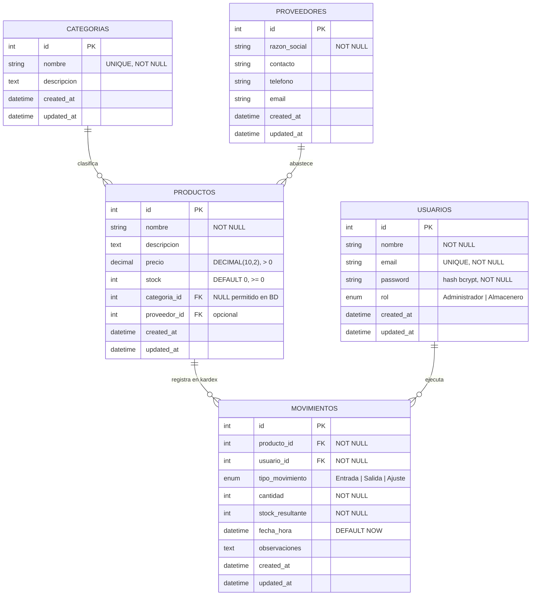

# DER - Panel Administrativo de Inventario (Laboratorio #9)

Base de datos MySQL con 5 tablas. `Productos` es la tabla central: cada
producto pertenece a una categoría y, opcionalmente, a un proveedor. Los
`Movimientos` forman el kardex: cada fila guarda quién movió qué, cuánto y con
qué stock quedó el producto.

## Cardinalidades

| Relación | Cardinalidad | Clave foránea | Borrado |
|---|---|---|---|
| Categoría → Productos | 1 : N | `Productos.categoria_id` | `RESTRICT` |
| Proveedor → Productos | 1 : N (opcional) | `Productos.proveedor_id` | `RESTRICT` |
| Producto → Movimientos | 1 : N | `Movimientos.producto_id` | `RESTRICT` |
| Usuario → Movimientos | 1 : N | `Movimientos.usuario_id` | `RESTRICT` |

`RESTRICT` evita borrar un registro que todavía tiene hijos. La API además
comprueba las dependencias antes de borrar y responde `409` con un mensaje
explicando cuántos registros relacionados existen.

## Nota sobre `categoria_id`

La columna admite `NULL` en la base de datos porque la tabla `Productos` ya
existía desde el Laboratorio #7 con filas sin categoría. La API, en cambio, sí
exige `categoria_id` al crear o editar un producto, de modo que todo registro
nuevo queda siempre clasificado.
